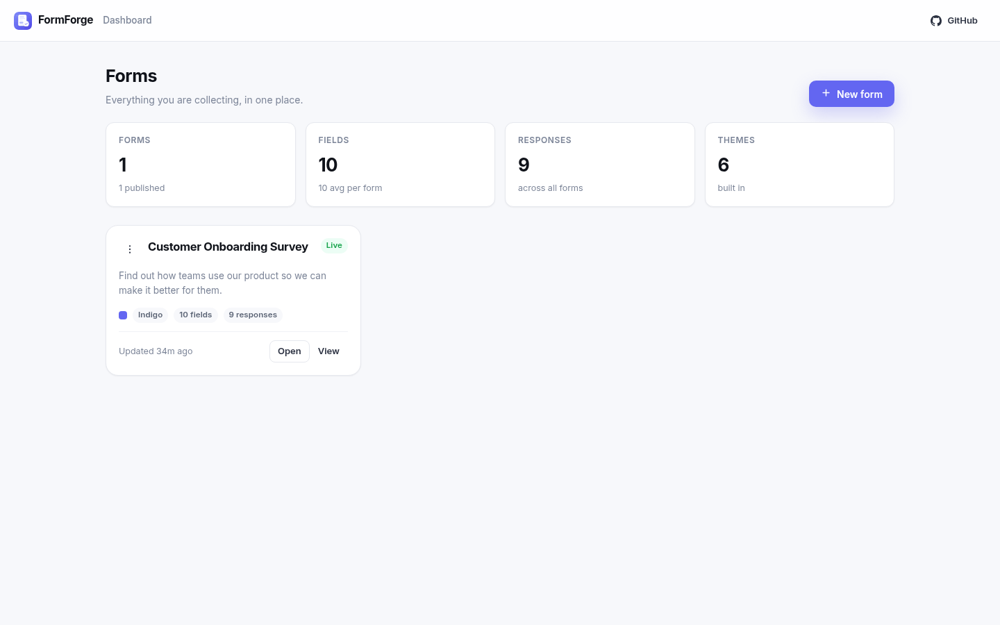
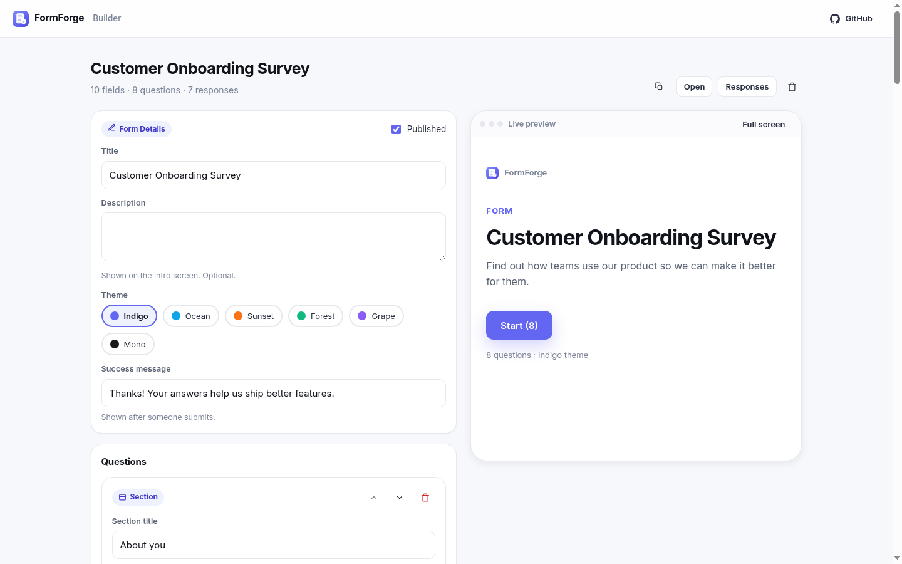

<p align="center">
  
</p>

<h1 align="center">FormForge</h1>

<p align="center">
  <strong>Open-source Typeform Pro alternative.</strong>
</p>

<p align="center">
  Build beautiful one-question-at-a-time forms with branching logic,
  response analytics and shareable public links — with real persistence in SQLite
  and a single npm dependency.
</p>

<p align="center">
  
  
  
  
  <a href="https://github.com/0xshaikh/formforge/actions">
    
  </a>
</p>

---

## Why

Typeform Pro is **$25/month per user** and pricing scales with response volume,
which makes it painful for teams, side projects and internal tools. FormForge
gives you the same core experience — polished one-question-at-a-time forms,
skip logic, analytics, public share links — as a self-hosted app you own
outright.

## Features

- **Typeform-style form walker** — one question at a time, keyboard-first
  (press **Enter** to advance), progress bar, Back/Skip navigation and a
  customisable success message.
- **14 field types** — `section`, `text`, `paragraph`, `email`, `number`, `url`,
  `phone`, `radio`, `checkboxes`, `dropdown`, `rating`, `scale`, `yesno`, `date`.
- **Branching logic** — conditional show/skip with 9 operators
  (`equals`, `not_equals`, `gt`, `gte`, `lt`, `lte`, `contains`, `empty`,
  `not_empty`) and forward jump targets. Conditions can only reference earlier
  fields, so impossible loops are rejected at write time.
- **Response analytics** — per-field answer counts, averages for numeric fields,
  a daily time series and completion metrics.
- **Visual form builder** — inline field editing, reorder, field palette,
  theme picker and a **live preview pane** that re-renders as you type.
- **Shareable public forms** — every form gets a token URL
  (`/#/s/<token>`) plus an embeddable variant (`/#/e/<token>`).
- **6 themes** — indigo, ocean, sunset, forest, grape, mono.
- **Draft / publish toggle** — unpublished forms serve metadata but reject
  submissions.
- **Real persistence** — SQLite via Node's built-in `node:sqlite` module.
  No native compilation, no ORM, no external database.
- **Zero build step** — the frontend is plain ES modules served statically.

## Screenshots

| Dashboard | Builder with live preview |
| --- | --- |
|  |  |

## Quick start

```bash
git clone https://github.com/0xshaikh/formforge.git
cd formforge
npm install
npm run seed    # creates a demo form with 10 fields and 7 responses
npm start       # http://localhost:3000
```

Then open <http://localhost:3000> and click **New form**, or open the seeded
form's share link from the dashboard.

### Docker

```bash
docker build -t formforge .
docker run -p 3000:3000 -v formforge-data:/data --rm formforge
```

The database lives at `/data/formforge.db` inside the container.

### Environment variables

| Variable | Default | Description |
| --- | --- | --- |
| `PORT` | `3000` | HTTP port |
| `FORMFORGE_DB` | `data/formforge.db` | SQLite database path |
| `LOG_REQUESTS` | `1` | Set `0` to silence the access log |

## Scripts

| Command | Description |
| --- | --- |
| `npm start` | Run the server |
| `npm run dev` | Run with auto-restart on change (`node --watch`) |
| `npm run seed` | Load demo data into an empty database |
| `npm test` | Run the end-to-end API test suite (36 tests) |

## API

All endpoints return JSON and are mounted under `/api`.

### Forms

| Method | Path | Description |
| --- | --- | --- |
| `GET` | `/api/forms` | List forms with response counts |
| `POST` | `/api/forms` | Create a form |
| `GET` | `/api/forms/:id` | Get a form with its fields |
| `PATCH` | `/api/forms/:id` | Update title / description / theme / success message / published |
| `DELETE` | `/api/forms/:id` | Delete a form (cascades to fields and responses) |
| `POST` | `/api/forms/:id/duplicate` | Clone a form and its fields |
| `GET` | `/api/forms/types` | Field types and themes metadata |
| `GET` | `/api/forms/share/:token` | Resolve a share token to a form |

### Fields

| Method | Path | Description |
| --- | --- | --- |
| `PUT` | `/api/forms/:id/fields` | Replace the whole field set (re-writes branch references) |
| `POST` | `/api/forms/:id/fields` | Append a single field |
| `PATCH` | `/api/forms/:id/fields/:fieldId` | Update one field |
| `DELETE` | `/api/forms/:id/fields/:fieldId` | Delete one field |

### Responses

| Method | Path | Description |
| --- | --- | --- |
| `GET` | `/api/forms/:id/responses` | List responses (`limit` / `offset`) |
| `POST` | `/api/forms/:id/responses` | Submit answers `{ answers: { fieldId: value } }` |
| `DELETE` | `/api/forms/:id/responses/:responseId` | Delete one response |
| `GET` | `/api/forms/:id/responses/analytics` | Aggregated analytics |

### Misc

| Method | Path | Description |
| --- | --- | --- |
| `GET` | `/api/health` | Health check |

A required-field violation returns **422** with a `details` array describing
each missing or invalid field.

## Tech stack

- **Runtime** — Node.js ≥ 22.5 (uses the built-in `node:sqlite` module)
- **Backend** — Express 4, hand-written routes, no ORM
- **Storage** — SQLite (`node:sqlite`), single file, no native dependencies
- **Frontend** — vanilla ES modules + hand-written CSS (no framework, no bundler)
- **Testing** — end-to-end API tests against a real HTTP server on an ephemeral port
- **CI** — GitHub Actions on a Node 22 / 24 matrix
- **Container** — `node:22-alpine`, non-root user

## Project structure

```
formforge/
├── server/
│   ├── index.js          # Express app, static serving, SPA fallback
│   ├── db.js             # node:sqlite connection + schema
│   ├── validate.js       # field/thema/branch validation
│   ├── seed.js           # demo data
│   └── routes/
│       ├── forms.js      # form + field CRUD, share tokens, metadata
│       └── responses.js  # responses CRUD + analytics
├── public/
│   ├── index.html        # SPA shell
│   ├── css/app.css       # design system + 6 themes
│   └── js/
│       ├── app.js        # hash router
│       ├── api.js        # REST client
│       ├── util.js       # DOM helpers
│       ├── dashboard.js  # form list
│       ├── builder.js    # visual builder + live preview
│       ├── formview.js   # one-question-at-a-time renderer
│       ├── responses.js  # responses + insights
│       ├── branching.js  # skip-logic engine
│       ├── icons.js      # SVG icon set
│       └── themes.js     # theme catalogue
├── test/api.test.js      # 36 end-to-end tests
├── screenshots/
├── icon.svg / favicon.svg
├── Dockerfile
└── .github/workflows/ci.yml
```

## Branching semantics

A field's `condition` is evaluated against earlier answers:

```json
{ "field_id": 8, "operator": "gte", "value": 4 }
```

Meaning: *show this question only if field 8's answer is ≥ 4*. Numeric
comparisons coerce both sides to numbers. When a referenced answer is missing
the condition fails (fail-closed), so the walk is always deterministic.

Two guards keep the graph sane:

- A condition may only reference a field that appears **earlier** in the list
  (otherwise: `400 field X cannot depend on field Y: it appears later in the form`).
- `next_field_id` jumps may only point **forward**, so loops are impossible.

## Roadmap

- Per-form API keys and CSV/JSON export of responses
- Drag-and-drop field reordering in the builder
- Recaptcha / rate limiting on public submissions
- Multi-language forms

## Contributing

Issues and pull requests are welcome. Run `npm test` before opening a PR.

## License

[MIT](./LICENSE) © 2026 0xshaikh
